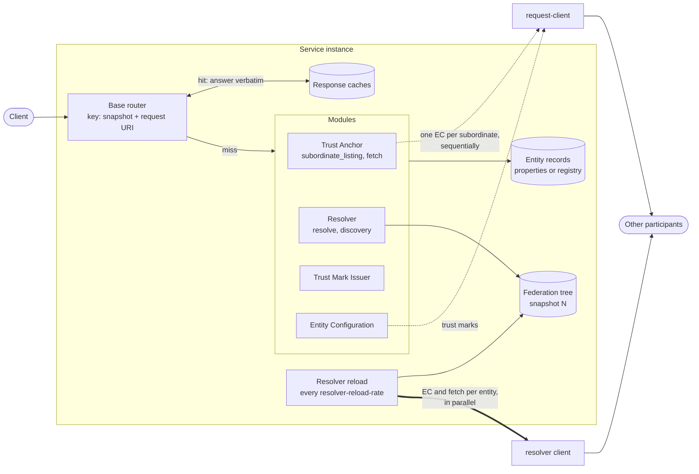
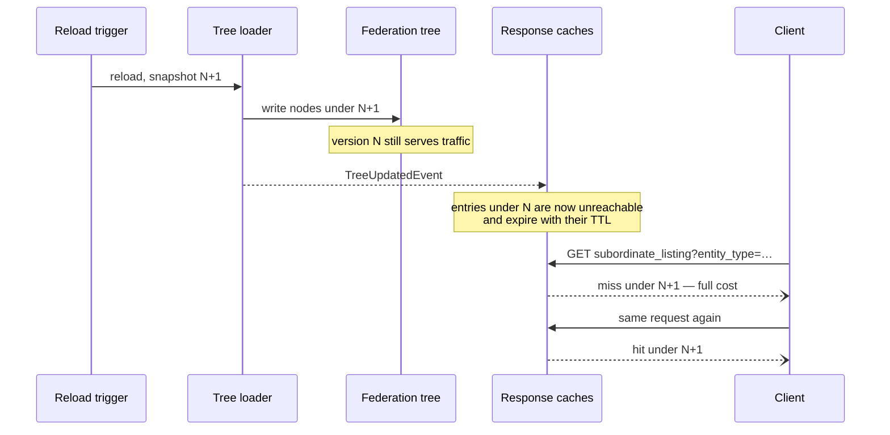
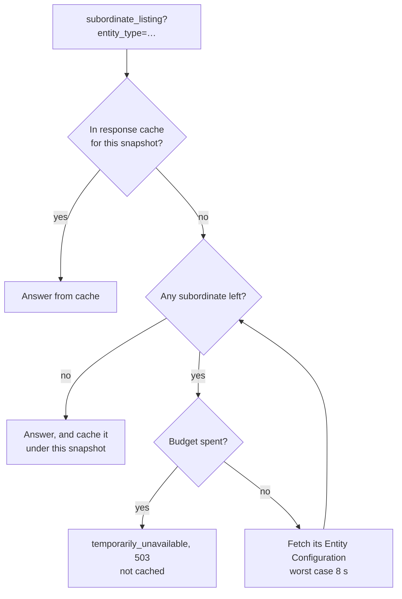
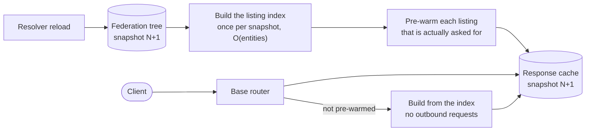

# Caches and Scale

A sketch of how the service is put together, with the focus on its caches, and of what a filtered
`subordinate_listing` has to look like to answer for 300–600 subordinates.

Related: [Cache](Cache.MD) for the snapshot model, [Routing](Routing.MD) for how a request finds its
entity, and [Outbound HTTP Clients](../service-configuration.md#26-outbound-http-clients) for the
clients, pools and timeouts referred to below.

---

## 1. The two paths

Everything the service does falls on one of two paths. They share the caches but nothing else.

**The background path** rebuilds the federation tree on a schedule. It walks the federation from the
Trust Anchor, fetching the Entity Configuration of every entity and the Subordinate Statements of every
Intermediate, and writes the result into a new snapshot. It is the only place where what other
participants say is kept.

**The request path** answers inbound requests. Most endpoints are answered from the entity records and
the tree. Two reach out to other participants while a client waits: a filtered `subordinate_listing`,
and an Entity Configuration that is configured with a trust mark source. These are drawn as dashed
lines above, and they are what sets the ceiling on how many subordinates the service can handle.

---

## 2. The caches

| Cache                       | Key                                      | Holds                                                                        | Written by                      |
|-----------------------------|------------------------------------------|------------------------------------------------------------------------------|---------------------------------|
| Federation tree             | module entity id + snapshot + node key   | A `ScrapedEntity` per node: its Entity Configuration, its trust mark statuses, and its Subordinate Statements if it is an Intermediate | The resolver reload             |
| Module response cache       | snapshot + request URI                   | The serialized response of a module endpoint, `subordinate_listing` among them | The base router, after a 2xx    |
| Subordinate fetch cache     | snapshot + fetch request                 | `/fetch` responses                                                           | The Trust Anchor router         |
| Resolver response cache     | snapshot + resolve request               | `/resolve` responses                                                         | The Resolver router             |
| Trust mark caches           | snapshot + request                       | Trust mark and trust mark status responses                                   | The Trust Mark Issuer router    |
| Entity configuration cache  | snapshot + entity id                     | The Entity Configurations this service issues for its own entities           | The Entity router               |
| Entity records              | instance                                 | The records that define the hosted entities                                  | The registry load               |

All the snapshot-keyed caches are either Redis or in-memory, chosen by `federation.service.storage`,
and all of them expire after `max(2 × resolver-reload-rate, 10 minutes)`. The TTL is a safety net, not
the invalidation mechanism — see the next section.

Two things are worth reading off the table:

- **Every cache but the tree stores what the service answered, not what it fetched.** There is no cache
  of other participants' Entity Configurations on the request path. Each filtered
  `subordinate_listing` that misses the response cache fetches every subordinate again.
- **The tree already holds what a filtered listing needs.** A `ScrapedEntity` carries the Entity
  Configuration it was scraped from, the status of each of its trust marks, and when it was scraped or
  last failed. Nothing on the Trust Anchor path reads it.

---

## 3. Snapshot rotation

A snapshot version is the epoch second at which a reload started. Reads use the newest version, writes
during a reload use the version being built, so a request is never answered from a half-built tree.

The consequence is a cost spike on each rotation, not a gradual decay: every cached response becomes
unreachable at the same moment, and the first client to ask for each one pays for it. Nothing
pre-warms `subordinate_listing` today, so for a filtered listing that first client pays the whole
sequential scan. The Grafana export is the one endpoint that avoids this, by computing its response on
`TreeUpdatedEvent` and putting it in the response cache for the new snapshot before anyone asks.

There is also no single-flight: requests that arrive while the first one is computing all do the same
work. At 10 requests per second during a 30-second scan, that is 300 scans at once.

---

## 4. What a filtered listing costs today

The scan is sequential, so its cost is the sum of its requests, and it is bounded only by the
[listing budget](../service-configuration.md#listing-budget):

| Subordinates | 50 ms each | 150 ms each | One unreachable subordinate |
|--------------|------------|-------------|-----------------------------|
| 22           | 1.1 s      | 3.3 s       | + up to 8 s                 |
| 300          | 15 s       | 45 s        | + up to 8 s                 |
| 600          | 30 s       | 90 s        | + up to 8 s                 |

At 300–600 subordinates the endpoint cannot work on this shape at all. With the default 10-second
budget every filtered request answers `503`; without a budget it answers after a minute or more, which
no client waits for, and it does so once per snapshot rotation per filter. **The fix is not a larger
budget or a larger pool — it is to stop fetching on the request path.**

---

## 5. What the rebuild costs at that size

The rebuild fetches, per entity, one Entity Configuration and one Subordinate Statement, plus one
subordinate listing per Intermediate and one status request per trust mark:

| Subordinates | Requests per rebuild | Per rebuild interval of 10 minutes |
|--------------|----------------------|------------------------------------|
| 300          | ≈ 600–1 200          | 1–2 per second, in bursts          |
| 600          | ≈ 1 200–2 400        | 2–4 per second, in bursts          |

The rebuild fans out over the tree on virtual threads with no limit on how many requests are in flight,
so the real limit is the connection pool. Two defaults become load-bearing at this size:

- **`max-total` 100.** A fan-out of 1 200 means ~1 100 requests waiting for a connection. A request
  that waits longer than `connection-request` (5 s) fails, and its branch falls back to the previous
  snapshot's data — a scrape failure caused by nothing but our own pool.
- **`max-per-route` 24.** Entities often share a host. If 600 subordinates live under one domain, 24 is
  the real concurrency, whatever `max-total` says.

So the rebuild scales, but only if the fan-out is bounded deliberately and the pool is sized for it,
rather than being bounded by a lease timeout.

---

## 6. How a solution should be shaped

The shape that holds at 300–600 subordinates follows from one rule: **a filtered listing is answered
from the snapshot, never from the network.** The data is already scraped; the request path only has to
read it. The cost of a listing then depends on the size of the answer, not on how many subordinates
are unreachable.

What that requires:

1. **Read the tree, not the peers.** Take the Entity Types and trust marks of each subordinate from its
   `ScrapedEntity`. The request path makes zero outbound requests, and the budget and the timeouts stop
   being part of answering a listing.
2. **Index once per snapshot.** Build `entity_type → subordinates` and `trust_mark_type → subordinates`
   when the snapshot is created, O(entities) once, rather than a scan per request.
3. **Pre-warm, as the Grafana export already does.** On `TreeUpdatedEvent`, write the listings for the
   filters that occur in the federation into the response cache under the new snapshot. The set is
   bounded — the Entity Types that exist, the trust mark types that exist, `intermediate=true`,
   `trust_marked=true` — so the first client after a rotation is not the one that pays. Note that the
   event also promotes the snapshot version, in a listener ordered first, so anything warming the cache
   must run after it to write under the new version.
4. **Decide what a stale or failed node means, and make it timing-independent.** A node carries
   `scrapedAt` and `scrapeFailedAt`. A listing built from a snapshot where some nodes failed their last
   scrape has to give the same answer to two identical requests: either include them with unknown
   types, as the endpoint does today, or refuse the listing when the snapshot is too old. Not "whatever
   we happened to have".
5. **Give the Trust Anchor a tree to read.** The tree is built by the Resolver module for its own Trust
   Anchor. A hosted Trust Anchor or Intermediate that no resolver covers has no snapshot to answer
   from, and needs either its own bounded scrape of its subordinates — which it can run in parallel,
   since nothing is waiting on it — or a documented requirement that a resolver covering it is
   configured.
6. **Bound the fan-out of the rebuild explicitly** and size `max-total` and `max-per-route` to that
   bound, so that queueing for a connection is not what limits the rebuild.
7. **Refresh per entity rather than everything every cycle.** At 600 subordinates a full rebuild is
   1 200+ requests every 10 minutes, nearly all of them returning what we already had. The `Cache`
   interface already has `shouldRefresh`; a per-entity freshness check turns the rebuild into work
   proportional to what changed.
8. **Compute once per snapshot.** Anything still computed lazily needs single-flight, or every client
   that arrives after a rotation computes it again.

---

## 7. What this buys

| | Today, filtered listing | From the snapshot |
|---|---|---|
| Outbound requests per request | One per subordinate | None |
| Cost at 600 subordinates | 30–90 s, or 503 on the budget | A Redis read, or an O(N) pass |
| Effect of one unreachable subordinate | Up to 8 s added, or the whole listing fails | None until the next rebuild |
| Cost of a snapshot rotation | The first client pays the whole scan | Paid by the rebuild, before anyone asks |
| Depends on client timing | Yes, which is why it answers 503 | No |

---

## 8. Open questions

- Which filter combinations are worth pre-warming, and is the set bounded by what the federation
  contains or by what clients actually ask for?
- How old may a snapshot be before a listing built from it should be refused rather than served?
- Should a subordinate that is in the records but missing from the tree be listed, left out, or make the
  listing fail?
- Is a hosted Trust Anchor without a resolver covering it a configuration we support, or one we reject
  at startup?
